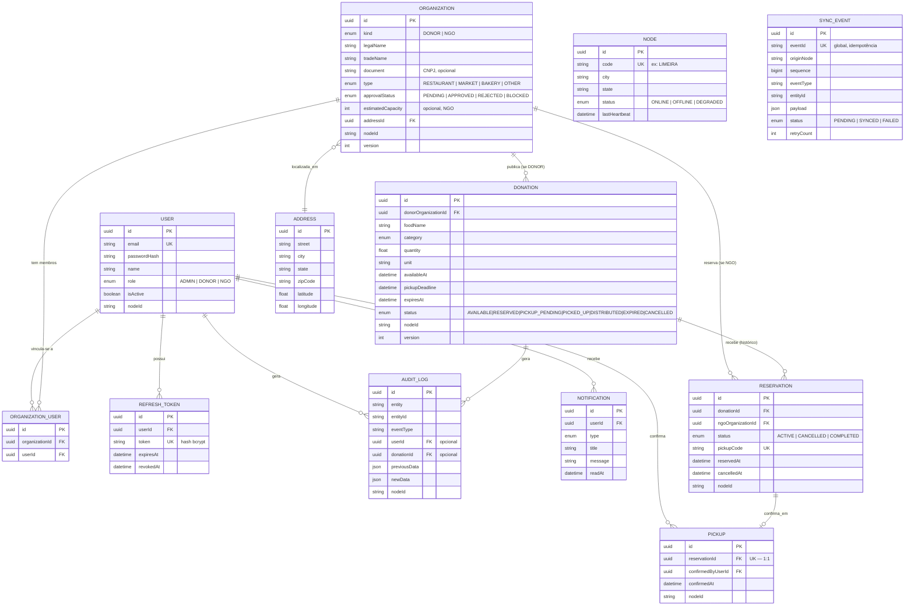

# Diagrama Entidade-Relacionamento

Gerado a partir de [`apps/api/prisma/schema.prisma`](../apps/api/prisma/schema.prisma)
(fonte da verdade — este diagrama deve ser atualizado se o schema mudar).

## Notas de design

- **`Organization` unifica Doador e ONG** (campo `kind`) em vez de duas
  tabelas — evita duplicar endereço/aprovação/contato, que são idênticos
  entre os dois perfis. Justificativa completa no README, seção "Modelo de
  dados (Fase 1)".
- **`Reservation.donationId` não é único** — uma doação pode ter várias
  reservas ao longo do tempo (cada cancelamento libera a doação para nova
  reserva); só uma `ACTIVE` por vez, garantido por transação (não por
  constraint de unicidade). Ver "Decisões de arquitetura (Fase 5)" no README
  para o bug original e a correção.
- **`Node` e `SyncEvent` não têm foreign key para `Organization`/`Donation`**
  — são tabelas de infraestrutura de sincronização, desacopladas do domínio
  de negócio por design (`entityId` é uma referência solta, não uma FK).
- **`Notification`** existe no schema (seção 30 da especificação prevê
  notificações internas) mas o serviço de emissão/consulta não foi
  implementado nas 14 fases deste projeto — gap conhecido, registrado nas
  limitações do [ARQUITETURA.md](ARQUITETURA.md).
